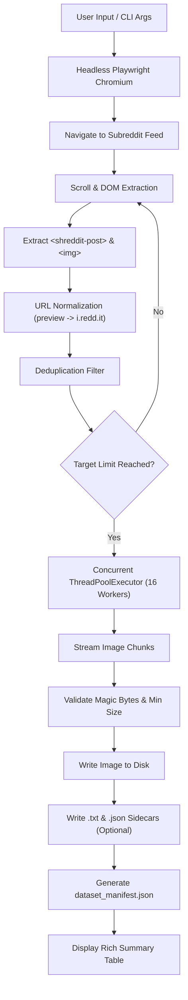

<div align="center">


# ⚡ REDDIT DATASET GRABBER

### *Ultra High-Speed Reddit Media & AI Dataset Engine*

[](https://github.com/Boozwooz/Reddit-scraper/releases)
[](https://python.org)
[](https://playwright.dev)
[](LICENSE)
[](https://github.com/Boozwooz/Reddit-scraper)

<br/>

**A modern, headless browser scraper and multi-threaded dataset harvester engineered to download thousands of uncompressed high-resolution images from any subreddit in seconds.**

*Built from the ground up to create pristine datasets for Stable Diffusion, Flux, LoRA, Kohya_ss, and AI vision model training.*

> [!NOTE]
> **✨ 100% VIBE CODED ✨** — Written with maximum flow, cutting-edge Python patterns, headless browser automation, and rich terminal aesthetics.

</div>

---

## 📑 Table of Contents

- [🌟 Key Features](#-key-features)
- [⚡ Quick Start](#-quick-start)
  - [Windows (1-Click)](#1-windows-1-click)
  - [Linux & macOS](#2-linux--macos)
  - [Manual Setup](#3-manual-python-setup)
- [💻 CLI Usage & Flags](#-cli-usage--flags)
- [🤖 AI & LoRA Dataset Mode](#-ai--lora-dataset-mode)
- [🔄 Architecture & Flow](#-architecture--flow)
- [🛡️ Anti-Stuck & Validation Engine](#️-anti-stuck--validation-engine)
- [📂 Project Structure](#-project-structure)
- [🤝 Contributing](#-contributing)
- [📄 License](#-license)

---

## 🌟 Key Features

- 🚀 **Next-Gen Playwright Automation**: Bypasses Reddit's modern dynamic single-page web app (`shreddit` web components, shadow DOM, dynamic feed hydration) without relying on brittle, restricted API keys.
- 🎯 **Full-Resolution Uncompressed Extraction**: Automatically detects and upgrades preview thumbnails (`preview.redd.it?width=...`) into raw, full-resolution source image URLs (`i.redd.it`).
- ⚡ **Multi-Threaded Turbo Downloader**: Powered by concurrent `ThreadPoolExecutor` workers streaming chunks to disk with exponential backoff retries.
- 🤖 **AI Dataset Sidecars (`--save-metadata`)**: Automatically creates:
  - `.txt` caption files containing post titles (ready for Kohya_ss, SDXL, and Flux LoRA fine-tuning).
  - `.json` sidecars containing metadata (author, upvotes, permalink, dimensions).
  - Consolidated `dataset_manifest.json` for reproducible research.
- 🛡️ **Magic-Byte Integrity Verification**: Automatically checks binary image headers (`JPEG`, `PNG`, `WebP`, `GIF`) and enforces minimum file sizes, rejecting corrupt payloads and HTML error pages.
- 🔁 **Built-in Deduplication**: Reads destination folder before downloading to instantly skip files that have already been retrieved.
- 🎨 **Futuristic Terminal UI**: Stunning visual feedback powered by `rich`, featuring animated spinners, speed meters, percentage bars, and clean execution summaries.
- 🖱️ **Double-Click Windows Launcher**: Comes bundled with `RUN.bat` for instant zero-configuration execution.

---

## ⚡ Quick Start

### 1. Windows (1-Click)

Simply double-click `RUN.bat`. It will automatically check Python dependencies, verify Chromium binaries, and launch the interactive setup menu.

```cmd
RUN.bat
```

### 2. Linux & macOS

Mark the script as executable and run:

```bash
chmod +x run.sh
./run.sh
```

### 3. Manual Python Setup

```bash
# Clone the repository
git clone https://github.com/Boozwooz/Reddit-scraper.git
cd Reddit-scraper

# Install required dependencies
pip install -r requirements.txt

# Install Playwright Chromium engine
playwright install chromium

# Run interactively
python reddit_grabber.py
```

---

## 💻 CLI Usage & Flags

You can run `reddit_grabber.py` either interactively (with prompt defaults) or as a scriptable command-line utility with flags:

```bash
# Scrape top 200 images from r/Cyberpunk of all time with 16 workers
python reddit_grabber.py --subreddit Cyberpunk --limit 200 --sort top --time all --workers 16

# Download images from r/LiminalSpace and generate AI training captions (.txt) and JSON sidecars
python reddit_grabber.py -s LiminalSpace -n 150 --save-metadata

# Scrape hottest posts from r/wallpapers into a custom directory
python reddit_grabber.py -s wallpapers -n 50 --sort hot -o ./my_wallpapers
```

### 🛠️ Options Reference

| Flag | Short | Type | Default | Description |
| :--- | :---: | :---: | :---: | :--- |
| `--subreddit` | `-s` | `str` | `LiminalSpace` | Target subreddit name (e.g. `wallpapers`, `EarthPorn`, `Art`) |
| `--limit` | `-n` | `int` | `100` | Target number of unique images to download |
| `--sort` | | `choice` | `top` | Reddit feed sorting: `top`, `hot`, `new`, `rising` |
| `--time` | `-t` | `choice` | `all` | Time window for `top` sort: `all`, `year`, `month`, `week`, `day`, `hour` |
| `--output` | `-o` | `str` | `dataset_<sub/` | Custom destination folder for scraped media |
| `--workers` | `-w` | `int` | `16` | Number of parallel worker threads for downloading |
| `--min-size` | | `int` | `10` | Minimum file size threshold in KB (filters out icons/placeholders) |
| `--save-metadata` | | `flag` | `False` | Saves `.txt` captions and `.json` sidecars for AI dataset training |
| `--no-headless` | | `flag` | `False` | Opens the browser in visible mode for debugging |

---

## 🤖 AI & LoRA Dataset Mode

When passing `--save-metadata` (or selecting `y` in the interactive menu), the grabber exports your dataset in the standard format expected by generative AI trainers like **Kohya_ss**, **ComfyUI**, **Diffusers**, and **EveryDream**:

```
dataset_LiminalSpace/
├── dataset_manifest.json                      # Consolidated metadata
├── LiminalSpace_07p702t8wnxg1.jpg             # High-res raw image
├── LiminalSpace_07p702t8wnxg1.txt             # Text caption (post title)
├── LiminalSpace_07p702t8wnxg1.json            # Post metrics & metadata
└── ...
```

### Text Caption (`.txt`) Example:
```text
An empty shopping mall corridor bathed in neon green light at 3 AM
```

### JSON Sidecar (`.json`) Example:
```json
{
  "file_id": "LiminalSpace_07p702t8wnxg1",
  "url": "https://i.redd.it/07p702t8wnxg1.jpg",
  "extension": ".jpg",
  "title": "An empty shopping mall corridor bathed in neon green light at 3 AM",
  "author": "CyberDreamer",
  "score": 1420,
  "permalink": "https://www.reddit.com/r/LiminalSpace/comments/...",
  "post_id": "07p702t8wnxg1",
  "subreddit": "LiminalSpace"
}
```

---

## 🔄 Architecture & Flow



---

## 🛡️ Anti-Stuck & Validation Engine

1. **Anti-Stuck Jitter**: Reddit feeds can lock or stall during heavy infinite scrolling. The engine detects identical scan cycles and dynamically sends `PageDown` events and adaptive scrolls to trigger new content hydration.
2. **Binary Header Inspection**: Every stream is verified against known magic byte signatures (`\xff\xd8\xff` for JPEG, `\x89PNG` for PNG, `RIFF....WEBP` for WebP, `GIF87a/89a` for GIF). Files that fail verification or fall below the minimum size (e.g. 10 KB) are automatically discarded.

---

## 📂 Project Structure

```
Reddit-scraper/
├── assets/
│   └── banner.png             # Cyberpunk project banner
├── .github/
│   └── workflows/
│       └── release.yml        # Automated GitHub Actions release pipeline
├── .gitignore                 # Safe exclusions (datasets, caches, envs)
├── LICENSE                    # MIT License
├── pyproject.toml             # Python package configuration
├── README.md                  # Project documentation
├── RELEASE_NOTES.md           # v1.0.0 Release Notes
├── requirements.txt           # Python dependencies
├── RUN.bat                    # Windows 1-Click launcher
├── run.sh                     # Linux/macOS launcher
└── reddit_grabber.py          # Main application
```

---

## 📄 License

Distributed under the **MIT License**. See [`LICENSE`](LICENSE) for more details.

---

<div align="center">

Crafted with 💖 and **100% Vibe Coded** by [**Boozwooz**](https://github.com/Boozwooz)

</div>
